<div align="center">

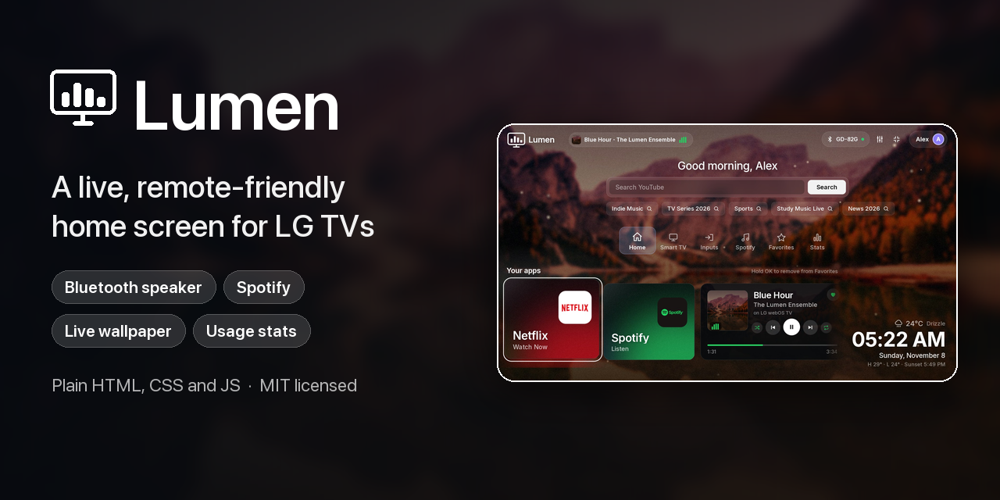

<br>

[](https://github.com/Sandanu06/lumen/actions/workflows/ci.yml)


[](LICENSE)

**Lumen replaces the first thing you see on your LG TV with a home screen you control:**
a live wallpaper that follows the sun, your apps and inputs, Bluetooth speaker control, Spotify, usage stats and a clock screen,
all driven by the TV remote. Plain HTML, CSS and JavaScript. No framework, no build step, nothing to run on your computer once it is installed.

<br>


<sub><a href="docs/media/demo.mp4">▶ Watch the full 40-second tour (MP4)</a></sub>

</div>

---

## Contents

[Features](#features) · [Screenshots](#screenshots) · [Quick start](#quick-start) · [Remote control](#using-it-with-the-remote) · [How it works](#how-it-works) · [Spotify: what to expect](#spotify-what-to-expect) · [Documentation](#documentation) · [Privacy and security](#privacy-and-security) · [Limitations](#limitations) · [Contributing](#contributing) · [License](#license)

## Features

| | |
|---|---|
| **Live home screen** | Wallpaper changes with the real time of day (dawn, day, dusk, night, from your local sunrise and sunset), slowly drifting with mist and floating lights. Smooth tab transitions, a logo intro, an idle clock screen. Everything animates with `transform` and `opacity` only, so it stays near 60 fps on the TV's modest GPU. |
| **Remote-first navigation** | Six tabs (Home, Smart TV, Inputs, Spotify, Favorites, Stats), spatial D-pad focus, Magic Remote pointer support, Back-button behaviour that does what you expect. Hold OK on any app to favourite it. |
| **Your apps, looking good** | Every installed app as a glowing card in its own brand colour, a favourites shelf, and a Continue card for the last app you opened. |
| **Bluetooth speaker control** | A chip in the header shows the current sound output. One panel to connect, disconnect, search for and pair speakers, and switch back to the TV speakers. Remembers your speaker and reconnects it automatically. |
| **Spotify** | Playlists, Liked Songs, a now-playing card with play, pause, skip, shuffle, repeat and a heart, a "playing now" pill in the header, resume where you stopped, and a device switcher. See [what to expect](#spotify-what-to-expect). |
| **TV controls** | Volume, mute, screen off and power off from a panel, plus real HDMI inputs with signal status. |
| **Usage stats** | How often and when you open apps, kept on the TV and never uploaded. |
| **Home-button service** | A small service on the TV brings Lumen back when the stock launcher appears. Press Home twice quickly to reach the real LG launcher. |
| **Self-maintaining** | The app renews its own Developer Mode session so it does not expire after about 50 hours. |
| **Sounds and weather** | Optional synthesised interface sounds (no audio files), live weather from Open-Meteo. |
| **Private by design** | No analytics, no accounts, no cloud service of ours. Secrets stay on your machine and your TV. |

## Screenshots

<table>
<tr>
<td width="50%">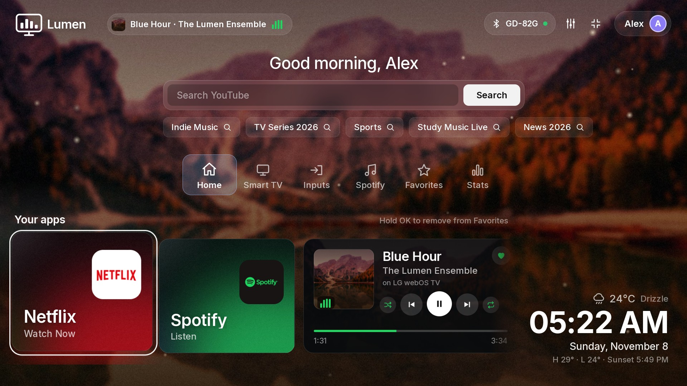<br><sub><b>Home</b>: your apps, what is playing, weather and clock</sub></td>
<td width="50%">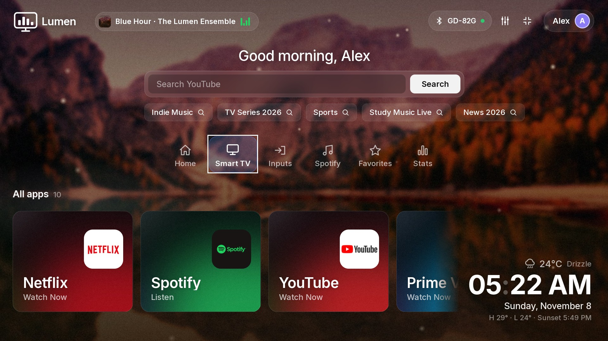<br><sub><b>Smart TV</b>: every app as a glowing card</sub></td>
</tr>
<tr>
<td>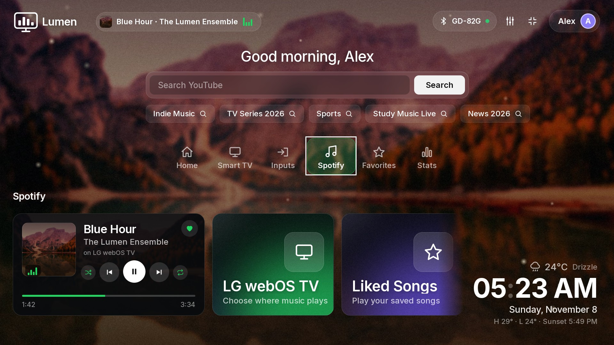<br><sub><b>Spotify</b>: player, device switcher, Liked Songs, playlists</sub></td>
<td>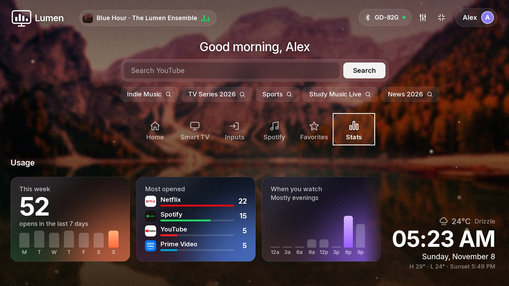<br><sub><b>Stats</b>: weekly opens, most opened, when you watch</sub></td>
</tr>
<tr>
<td>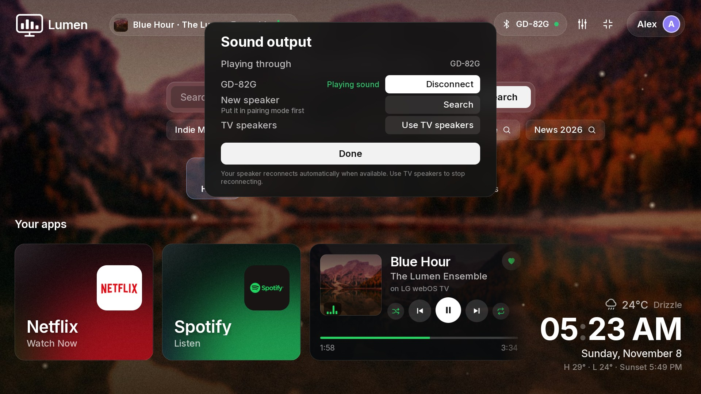<br><sub><b>Sound output</b>: Bluetooth speaker control</sub></td>
<td>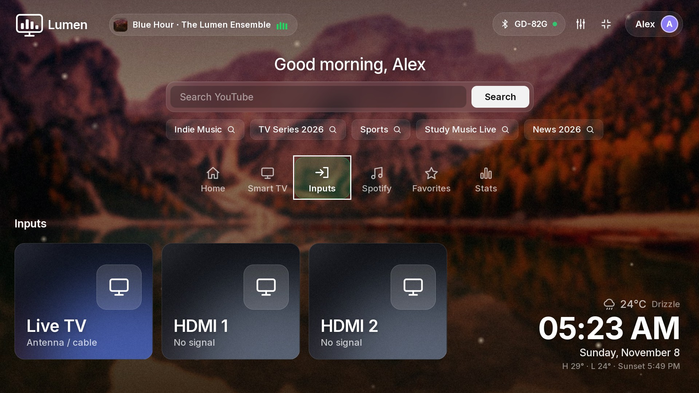<br><sub><b>Inputs</b>: Live TV and HDMI with signal status</sub></td>
</tr>
<tr>
<td>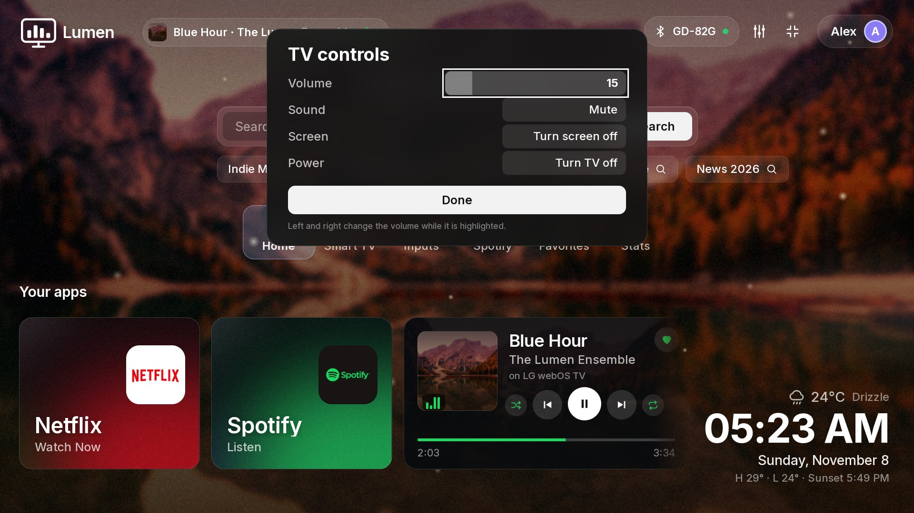<br><sub><b>TV controls</b>: volume, mute, screen and power</sub></td>
<td>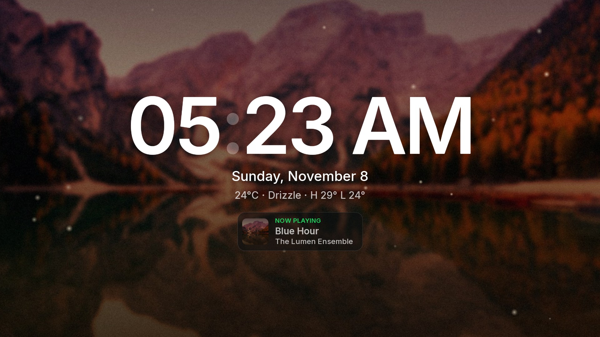<br><sub><b>Clock screen</b> after two idle minutes, with what is playing</sub></td>
</tr>
<tr>
<td>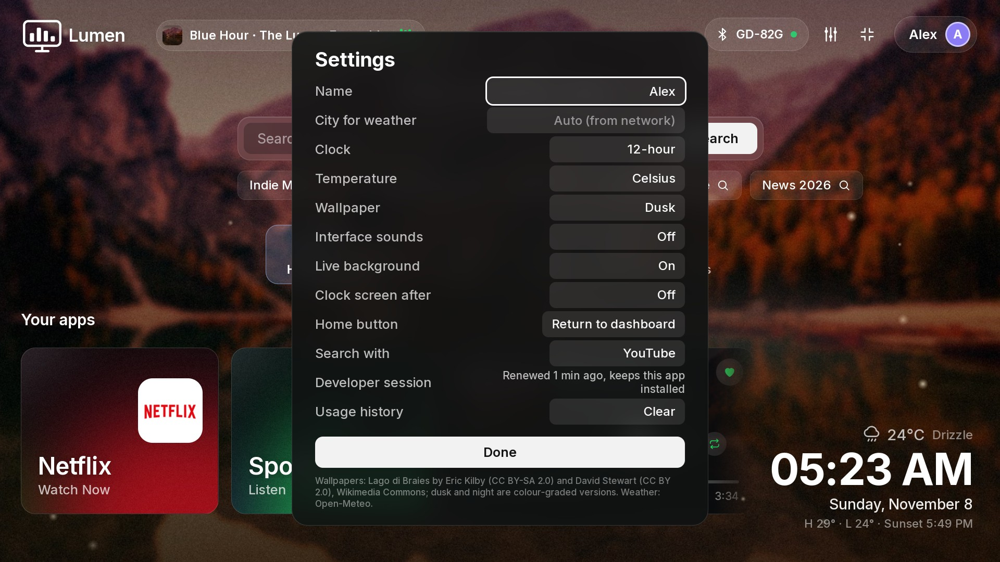<br><sub><b>Settings</b>: name, weather city, clock, wallpaper, sounds, Home button</sub></td>
<td>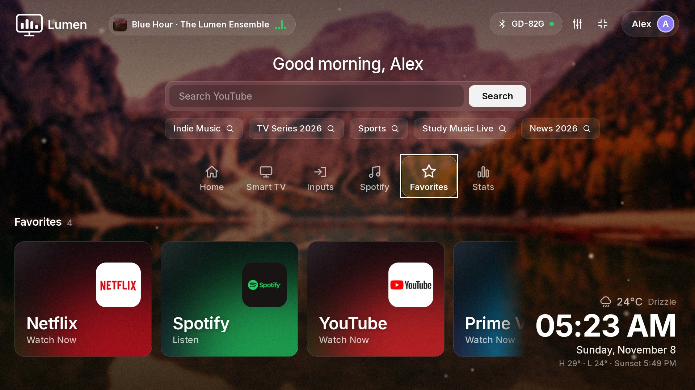<br><sub><b>Favorites</b>: hold OK on any app to add it</sub></td>
</tr>
</table>

**The wallpaper follows the sun** (dawn, day, dusk and night; pick one or leave it on Auto):

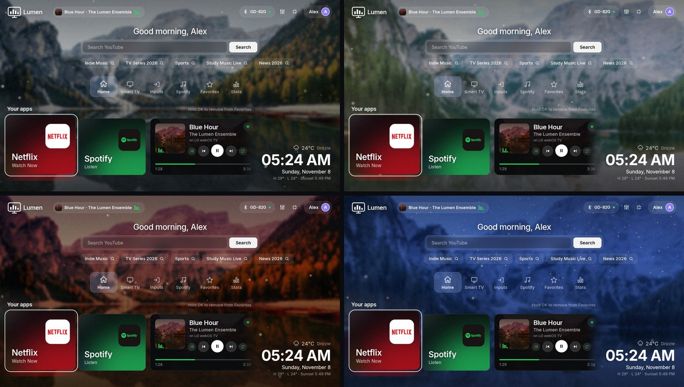

> The screenshots and video are captured from a real LG TV running Lumen, using a neutral demo profile (name "Alex", sample usage, a fictional track). `npm run docs:media` regenerates them.

## Quick start

You need an **LG webOS TV** (developed and tested on a 2021 LG UP75 running webOS 6; see [compatibility](docs/SETUP.md#compatibility)), a computer on the same network with **Node 18+**, and about ten minutes.

**1. Turn on Developer Mode on the TV** (one time)
Install **Developer Mode** from the LG Content Store, sign in with a free LG developer account, switch **Dev Mode Status** on (the TV restarts), then reopen the app and switch **Key Server** on. Leave that screen open. Step by step with pictures of each setting: [docs/SETUP.md](docs/SETUP.md).

**2. Get Lumen and run the setup**

```bash
git clone https://github.com/Sandanu06/lumen.git
cd lumen
npm install
npm run setup -- --ip <your TV's IP address> --passphrase <code shown in the Developer Mode app>
```

`setup` checks the TV, downloads the developer key, pairs with the TV (accept the prompt on screen once), writes your private config and reads your installed apps. It is safe to run again.

**3. Install it**

```bash
npm run deploy
```

Lumen opens on the TV. After this you can turn your computer off; it runs entirely on the TV.

**4. Optional: connect Spotify**

```bash
npm run spotify -- <your Spotify Client ID>
npm run deploy
```

Needs a free Spotify developer app and Spotify Premium. Details: [docs/SPOTIFY.md](docs/SPOTIFY.md).

> Prefer to look first? `npm install && npm run build` produces `dist/*.ipk` on any computer with no TV attached.

## Using it with the remote

| Key | Does |
|---|---|
| **◀ ▶ ▲ ▼** | Move between cards, tabs and buttons (nearest-neighbour focus) |
| **OK** | Open the focused app or press the focused button |
| **Hold OK** on an app | Add or remove it from Favorites |
| **Back** | Close a panel; from another tab go back to Home; on Home leaves Lumen |
| **Home** (LG remote) | Returns to Lumen. **Press twice within 6 seconds** to reach the stock LG launcher |
| **Play / Pause / FF / REW** | Control Spotify when something is playing |
| **Magic Remote pointer** | Hover to focus, click to open |

Full list, plus every setting: [docs/FEATURES.md](docs/FEATURES.md).

## How it works

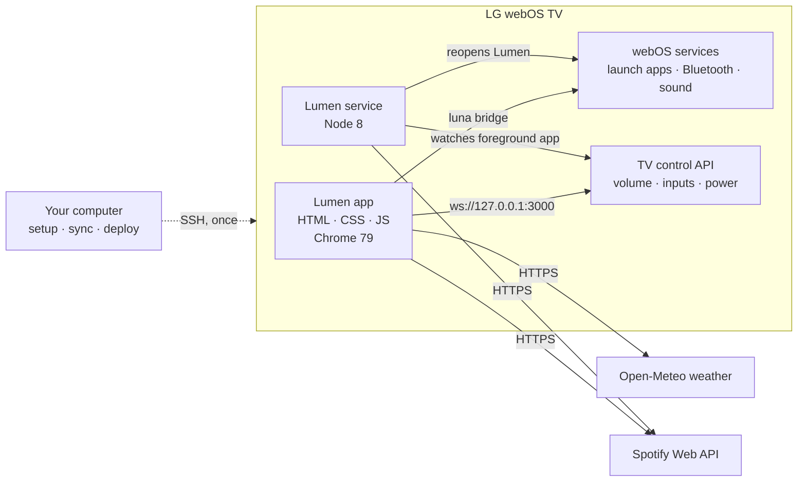

* **The app** is a static web app installed through Developer Mode. It talks to webOS through the luna service bridge (launching apps, Bluetooth, sound settings) and to the TV's own local control API (volume, inputs, power).
* **The service** is a tiny Node program that runs on the TV. It watches which app is in front and reopens Lumen when the stock launcher appears. It also starts Spotify on the TV when you ask for music.
* **Your computer** is only needed to install and to sync the app list. Nothing runs on it afterwards.

Design decisions, the Chrome 79 constraints, performance rules and file layout: [docs/ARCHITECTURE.md](docs/ARCHITECTURE.md).

## Spotify: what to expect

Lumen shows and controls Spotify, but **on this class of TV the music itself has to play in the TV's own Spotify app**, and I want to be upfront about what that means:

* Pressing a playlist opens the TV's Spotify app and plays there. Bluetooth speakers work because the real app owns the audio.
* **webOS closes the Spotify app the moment you leave it**, so music stops when you go Home. Lumen keeps your song, position and cover on the Spotify card, and **Resume** continues from the same second.
* I tried to play inside Lumen using Spotify's Web Playback SDK. It cannot work on these TVs: Spotify's player code needs a newer browser than the TV's Chrome 79 and fails at the licensing step. This is documented with the evidence in [docs/SPOTIFY.md](docs/SPOTIFY.md#why-music-stops-when-you-go-home).
* **Music that keeps playing while you use Lumen** is possible from any other Spotify device (phone, computer, a Raspberry Pi running Spotify Connect). Lumen then works as the remote and the display: now-playing pill, controls, device switcher.

## Documentation

| | |
|---|---|
| [Setup guide](docs/SETUP.md) | Developer Mode, setup, deploy, updating, uninstalling |
| [Features and settings](docs/FEATURES.md) | Every screen, every setting, every remote key |
| [Spotify](docs/SPOTIFY.md) | Create the Spotify app, connect, how playback works and its limits |
| [Architecture](docs/ARCHITECTURE.md) | Components, data flow, security model, TV constraints |
| [Design system](docs/DESIGN.md) | Colour, type, motion, focus language and the performance rules |
| [Development](docs/DEVELOPMENT.md) | Project layout, scripts, tests, debugging on the TV, regenerating assets |
| [Troubleshooting](docs/TROUBLESHOOTING.md) | The problems people actually hit, and fixes |
| [Changelog](CHANGELOG.md) | What changed in each version |

## Privacy and security

* **No telemetry.** Lumen talks to Open-Meteo (weather), Spotify (only if you connect it), and LG's Developer Mode endpoint (to renew its own session). Usage stats, favourites and settings are stored in the TV's local storage and never leave it.
* **Secrets never enter git.** Your TV pairing key, Developer Mode session token and Spotify token live in git-ignored files (`.lgtv-key`, `app/session.js`, `service/tv.json`, `app/spotify.js`). `npm run lint` fails the build if any of them is ever tracked.
* **Be aware:** the installed app contains your TV key and Spotify refresh token, because it has to authenticate to the TV and to Spotify. Treat the `.ipk` you build for your own TV as private and do not share it. Spotify sign-in uses PKCE, so no client secret is ever needed or stored.
* Found a vulnerability? See [SECURITY.md](SECURITY.md).

## Limitations

* webOS TVs only, and Developer Mode sessions need renewing if the TV sits unused for about 50 hours (Lumen renews it itself while the TV is in use).
* The stock LG launcher and system menus cannot be restyled without root. Lumen replaces the *experience* by opening first and after Home; it does not modify the firmware.
* Spotify cannot keep playing behind Lumen on the TV itself (see above).
* The TV's browser is Chrome 79, so the code avoids newer syntax and CSS. `npm run lint` enforces it.

## Contributing

Issues and pull requests are welcome. Start with [CONTRIBUTING.md](CONTRIBUTING.md) and [docs/DEVELOPMENT.md](docs/DEVELOPMENT.md). `npm run check` runs the linter and the test suite.

## License

[MIT](LICENSE) © 2026 Sandanu Hewage. Wallpapers, fonts and libraries have their own licences: see [THIRD_PARTY_NOTICES.md](THIRD_PARTY_NOTICES.md). Lumen is an independent project and is not affiliated with or endorsed by LG Electronics or Spotify. LG, webOS and Spotify are trademarks of their respective owners.
