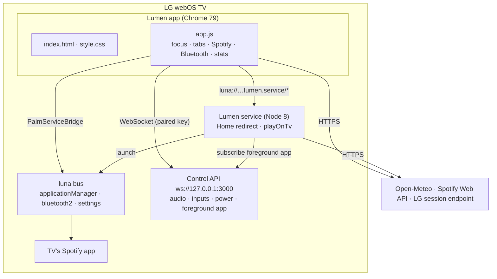

# Architecture

How Lumen is built, why, and what constrains it.

## Contents
[Overview](#overview) · [Repository layout](#repository-layout) · [The app](#the-app) · [The service](#the-service) · [Talking to the TV](#talking-to-the-tv) · [State and storage](#state-and-storage) · [Constraints of the TV](#constraints-of-the-tv) · [Performance](#performance) · [Security model](#security-model) · [Why no framework](#why-no-framework)

## Overview

Lumen is two things installed together as one `.ipk` package:

| Part | Runs | Language | Job |
|---|---|---|---|
| **App** (`app/`) | In the TV's web runtime (Chrome 79) | HTML, CSS, ES2018 JS | The home screen and everything you see |
| **Service** (`service/`) | In webOS's Node 8 service host | JavaScript | Brings Lumen back after Home, starts Spotify on the TV |

Your computer is used only by the tooling (`tools/`): setup, building, deploying, syncing the app list, generating artwork. After deploy nothing runs on it.



## Repository layout

```
app/
  index.html  style.css  app.js     the whole UI (one file each, no bundler)
  appinfo.json                      webOS app manifest (id, version, resolution)
  icon.png largeIcon.png splash.jpg launcher icons and launch splash
  fonts/  wallpapers/               Inter (OFL) and the four scenes (CC, see credits)
  pairing.js                        public LG control-API manifest (from the lgtv2 package)
  apps.js icons/ art/               generated per TV: your apps, their icons and card artwork
  session.js spotify.js             PRIVATE, written by setup / npm run spotify
service/
  service.js services.json package.json   the on-TV service
  tv.json                           PRIVATE, written at build time
tools/                              setup, build, sync, art, wallpapers, icons, Spotify sign-in, lint, docs media
tests/                              node:test suite (app logic and service logic in a vm sandbox)
docs/                               this documentation and its media
.github/                            CI workflow and templates
```

## The app

* **One page, three files.** `index.html` holds the structure and an SVG icon sprite, `style.css` the whole design system, `app.js` an IIFE with sections: state, sounds, luna bridge, TV control API, Bluetooth, controls, Spotify, shelf views, focus engine, settings, live background, clock/weather, lifecycle.
* **Focus engine.** Every focusable element has class `f`. D-pad moves to the nearest element in the pressed direction (distance along the axis plus a weighted cross-axis penalty), with special rules so ▲ from the shelf goes to the current tab and ▼ returns to the last card. Pointer hover moves focus only on a real pointer move.
* **Rendering** is imperative DOM (`render()` rebuilds the shelf for a tab). Cards are cheap, there are at most ~60, and rebuilding avoids stale state.
* **Tab transitions**: exit class per card in the direction of travel, a sweep, then `render(dir)` with directional entrance classes.
* **Lifecycle.** The app resets to Home when you return to it (`webOSRelaunch` and `visibilitychange`), pauses polling while hidden, and plays the logo intro only if it was not open in the last 20 minutes.

## The service

`service/service.js` registers five methods on `luna://com.sandman.home.service/`:

| Method | Purpose |
|---|---|
| `start` | Connects to the control API and starts watching the foreground app. Called whenever the app opens. |
| `enable {on}` | Turns the Home-button redirect on or off (Settings → Home button). |
| `pause {ms}` | Pauses the redirect (the header's Exit button uses 90 s). |
| `playOnTv {clientId, refreshToken, action, body}` | Opens the TV's Spotify app, waits for it to register as a device, then plays / pauses / skips / transfers. |
| `status` | Connection state and the last 40 log lines, for debugging. |

**Home redirect logic.** On each foreground-app change: if the stock launcher (`com.webos.app.home`) just appeared and the redirect is on, ask the control API to launch Lumen. The TV sometimes re-raises the launcher right after, so up to three retries follow within 2.5 s. A second Home press within 6 s *after Lumen has been seen again* counts as deliberate and pauses the redirect for two minutes.

**Why a service at all?** The app is sent to the background the moment it launches another app, and background web apps stop running. Anything that must continue after that (waiting for Spotify to register, bringing Lumen back) has to live in the service.

**Why does the service use the control API for the foreground app?** The luna `getForegroundAppInfo` call is denied to Developer Mode services (`Denied method call`), but the same information is available over the TV's local control WebSocket, with the pairing key.

## Talking to the TV

| Channel | Used for |
|---|---|
| **luna bridge** (`PalmServiceBridge`, from the app) | `applicationManager/launch`; `bluetooth2/adapter`, `device`, `a2dp` (status, connect, disconnect, pair, discovery); `settings/getSystemSettings` (sound output). Allowed for Developer Mode apps. |
| **Control API** (`ws://127.0.0.1:3000`, SSAP) | Volume, mute, sound-output change, external inputs list and switch, screen off, power off. Needs a paired client key (written by setup). |
| **LG Developer Mode endpoint** | `ResetDevModeSession.dev`, called with the TV's own session token to renew the session. |
| **Open-Meteo** | Weather, sunrise and sunset, city lookup. No API key. |
| **Spotify Web API** | Playback state and control, playlists, library. |

Things the TV **denies** to apps, which shaped the design: listing installed apps (so `npm run sync` bakes the list in), `luna-send` from SSH, and the foreground-app call for services.

## State and storage

Everything lives in the TV's local storage under one key, `home.v1` (JSON): name, clock and unit, wallpaper choice, favourites, usage history (last 400 opens), cached weather, Bluetooth preferences, the last Spotify track and position, intro timestamp, and the control key if the TV issued a new one. Clearing the app's data resets all of it. Nothing is sent anywhere.

## Constraints of the TV

Measured on a 55UP7550PTC:

* **Chrome 79** (webOS 6). No `aspect-ratio`, `inset`, `overflow: clip`, `color-mix()`, optional chaining `?.`, nullish `??`, `Array.at`, `structuredClone`, `:focus-visible`, container queries, or flex `gap`. `npm run lint` rejects them in `app/`.
* **Memory**: about 450 MB free for everything. The app's JS heap stays around 10 MB.
* **Screen**: 1920×1080 CSS pixels at devicePixelRatio 2 (4K panel). The layout is fixed at 1920×1080.
* **Widevine** is present, but Spotify's embedded player cannot run (see [SPOTIFY.md](SPOTIFY.md)).

## Performance

Frame rate is measured on the TV with a `requestAnimationFrame` counter. Findings that became rules:

| Rule | Why (measured cost) |
|---|---|
| Animate `transform` and `opacity` only | `box-shadow`, `border-color` or `filter: drop-shadow` on a moving element cost 10 to 20 fps each |
| Bake static effects into images | A full-screen grain overlay cost ~7 fps and a screen-wide colour glow ~10 fps; the dark scrim and dither are now baked into each wallpaper |
| No canvas particle layer | A 2-D canvas of floating lights cost ~10 fps; 22 CSS-animated elements cost almost nothing |
| Keep work out of the animated path | Idle ~59 fps; navigating ~58 fps; switching tabs rapidly ~38 fps |

## Security model

* **Pairing key and tokens are secrets.** They are written to git-ignored files and baked into the `.ipk` you build for *your* TV. `npm run lint` fails if any private file is tracked.
* **Spotify uses PKCE.** There is no client secret. The refresh token grants only the scopes listed in [SPOTIFY.md](SPOTIFY.md#permissions-requested) and can be revoked at https://www.spotify.com/account/apps.
* **The control API listens on your LAN.** Anyone on your network can ask the TV to pair; the TV shows a prompt you must accept. Lumen only ever talks to it over `127.0.0.1` from the TV.
* **No telemetry.** See the privacy section in the [README](../README.md#privacy-and-security).
* **Do not share a built `.ipk`**: it contains your keys. CI builds an `.ipk` with empty keys, for validation only.

## Why no framework

The UI is one screen of roughly sixty elements on a TV with 450 MB of free memory and a 2021 browser. A framework would add weight and a build step without removing any hard problem: the hard parts here (spatial focus, remote keys, webOS services, Chrome 79 quirks, 60 fps) are the same either way. Plain files also mean `git clone`, `npm run deploy`, done.
